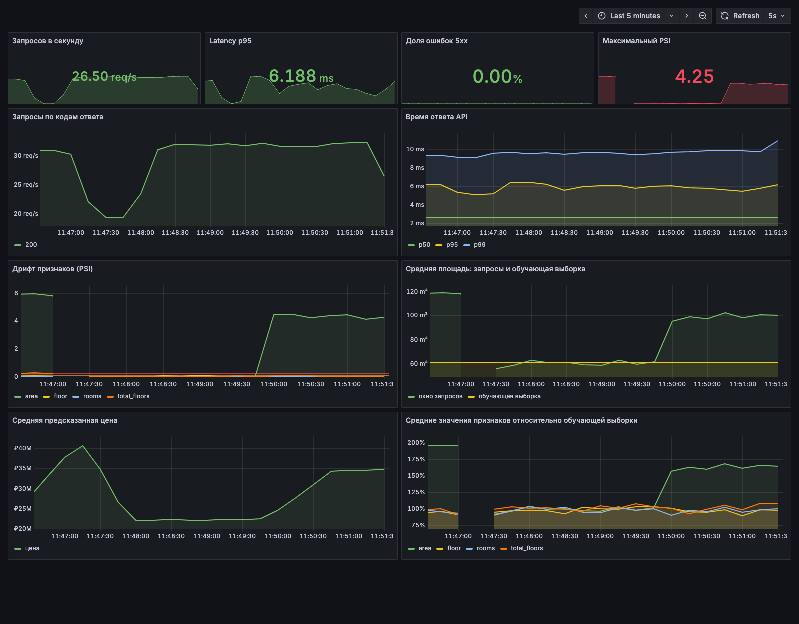

# Курс MLOps
Это учебный проект, направленный на создание модели машинного обучения для прогнозирования цен на жилье. 
Папка с [лекциями курса](https://drive.google.com/drive/folders/1HsI7IYoc-BrBrA6SRhxm1tzyCLtwnKht?usp=sharing).  
Модель использует различные характеристики объектов недвижимости для предсказания их рыночной стоимости.

## Защита семинаров

Отчет по семинарам сдается в личной беседе.  
Сделайте форк репозитория или заведите свой. 
Под каждую тему заводите отдельную ветку, merge в main через pull request. 
Ветки после PR не удалять! 
После прохождения курса ваш репо помимо main должен содержать следующие dev ветки: 
1. Разработка дизайн документа
2. Внедрение DVC
3. Внедрение MLflow
4. Внедрение дашборда мониторинга, CI/CD github actions
5. Внедрение чата Haystack + Ollama


### Архитектура сервиса 


### Как запустить
1. Клонируйте репозиторий:
```bash
git clone https://github.com/labintsev/mlops.git
```

2. Создайте venv и установите зависимости:
```bash
python -m venv venv
venv/Scripts/activate
pip install -r requirements.txt
```

4. Запустите сервис (модель по умолчанию берётся из `MODEL_NAME` в `.env`)
```sh
python service/app.py
# или с явным указанием модели из service/predict.py
python service/app.py -m baseline_const
# на macOS порт 5000 занят AirPlay, укажите другой
python service/app.py -p 8000
```
Веб приложение доступно по ссылке `http://127.0.0.1:5000`
API endpoint доступен  по ссылке `http://127.0.0.1:5000/api/numbers`

Чтобы добавить новую модель, объявите функцию `def my_model(X): ...` в `service/predict.py`
и зарегистрируйте её в словаре `MODELS` — после этого её можно выбрать через `-m` / `MODEL_NAME`.

## Сбор данных
Для сбора данных используем [Instant data scraper](https://chromewebstore.google.com/detail/instant-data-scraper/ofaokhiedipichpaobibbnahnkdoiiah?pli=1)


### Признаки
Используемые данные включают следующие характеристики:
* Площадь жилья
* Количество комнат
* Этаж квартиры
* Этажей в доме


## Версионирование данных (DVC)
Сырые данные (`data/*.xlsx`) и результаты обработки не хранятся в Git: в репозитории лежат только указатели `data.dvc` и `dvc.lock`, а сами файлы находятся в DVC remote.

Remote по умолчанию `myremote` указывает на локальную папку `../dvcstore` рядом с репозиторием. Чтобы использовать другое хранилище:
```sh
dvc remote add -d -f myremote /path/to/dvcstore
```

Получить данные и воспроизвести конвейер:
```sh
dvc pull
dvc repro
dvc metrics show
```

Стадии конвейера описаны в `dvc.yaml`:

| Стадия | Команда | Вход | Выход |
| :--- | :--- | :--- | :--- |
| `preprocess` | `python preprocess.py` | `data/` | `features/all_features.csv`, `reports/data_stats.json` |
| `train` | `python train.py` | `features/all_features.csv`, `params.yaml` | `models/*.pkl`, `reports/metrics.json`, `reports/feature_reference.json` |

Добавить новые данные:
```sh
dvc add data
dvc repro
dvc push
git add data.dvc dvc.lock reports/data_stats.json
git commit -m "update data"
```
Вернуться к предыдущей версии данных: `git checkout <commit> data.dvc dvc.lock && dvc checkout`.

## Обучение и трекинг экспериментов (MLflow)
Скрипт `train.py` обучает модели из `params.yaml` и константный baseline (медиана цены). Схема валидации: отложенная выборка 20% и 5-fold кросс-валидация на обучающей части.

Каждая модель записывается в MLflow отдельным запуском эксперимента `flat_price`:
* параметры модели и разбиения;
* метрики MAE и MAPE на train, validation (среднее по фолдам) и holdout;
* артефакт модели с сигнатурой и примером входа;
* теги `git_commit` и `data_version` (хэш данных из `data.dvc`).

Модели сохраняются в `models/<имя>.pkl` и регистрируются в реестре под именем `flat_price`. Лучшая по MAE на кросс-валидации модель получает алиас `champion`, если на отложенной выборке она точнее baseline.

```sh
dvc repro
dvc metrics show
mlflow ui --backend-store-uri sqlite:///mlflow.db
```
Интерфейс MLflow доступен по ссылке `http://127.0.0.1:5000`, поэтому сервис при одновременном запуске нужно поднять на другом порту или запустить MLflow с `--port 5001`.

Адрес трекинга задаётся переменной `MLFLOW_TRACKING_URI`, по умолчанию `sqlite:///mlflow.db`.

Запуск сервиса с обученной моделью:
```sh
python service/app.py -m ridge
python service/app.py -m models:/flat_price@champion
python service/app.py -m models/random_forest.pkl
```

Результаты на текущей версии данных (80 объявлений):

| Модель | MAE val, руб. | MAE holdout, руб. | MAPE holdout |
| :--- | ---: | ---: | ---: |
| `baseline_const` | 6 664 107 | 6 307 500 | 24.8% |
| `lin_reg` | 2 969 554 | 2 999 843 | 13.3% |
| `ridge` | 2 884 349 | 2 491 780 | 10.6% |
| `random_forest` | 3 097 604 | 2 864 231 | 11.7% |

## Тесты и CI/CD (GitHub Actions)
```sh
flake8 .
pytest
```
Тесты в `tests/` проверяют API (код ответа, формат, авторизацию, обработку ошибок), построение признаков, разбор объявлений, расчёт дрифта и поведение обученных моделей: правдоподобный диапазон цены и то, что цена не падает с ростом площади. Тесты моделей пропускаются, если `models/` пуста.

Workflow `.github/workflows/ci.yml` запускается при pull request и при push в `main`:

| Job | Что делает |
| :--- | :--- |
| `lint` | `flake8` |
| `test` | `pytest` |
| `docker` | сборка образа, smoke-тест контейнера, при push в `main` публикация образа в GitHub Container Registry |

## Мониторинг (Prometheus + Grafana)
Сервис отдаёт метрики в формате Prometheus на `GET /metrics`:

| Метрика | Описание |
| :--- | :--- |
| `flat_requests_total` | счётчик запросов по endpoint, методу и коду ответа |
| `flat_request_duration_seconds` | гистограмма времени ответа |
| `flat_predicted_price_rub` | гистограмма предсказанных цен |
| `flat_feature_mean`, `flat_feature_reference_mean` | среднее признака в окне последних 200 запросов и в обучающей выборке |
| `flat_feature_psi` | Population Stability Index признака относительно обучающей выборки |

Эталонное распределение признаков `reports/feature_reference.json` формируется при обучении. PSI меньше 0.1 означает отсутствие сдвига, от 0.1 до 0.25 умеренный сдвиг, больше 0.25 существенный дрифт.

Запуск сервиса, Prometheus и Grafana:
```sh
dvc pull
docker compose up -d --build
# если порт 5000 занят
APP_PORT=8000 docker compose up -d --build
```
* сервис: `http://localhost:5000`
* Prometheus: `http://localhost:9090`
* Grafana: `http://localhost:3000`, дашборд «Сервис прогнозирования цен на жилье» открывается без входа, администратор `admin` / `admin`

Модель выбирается переменной `MODEL_NAME` (по умолчанию `ridge`), папка `models/` монтируется в контейнер.

Правила оповещений описаны в `monitoring/alerts.yml`: недоступность сервиса, p95 времени ответа выше 500 мс, доля ошибок 5xx выше 5%, PSI признака выше 0.25.

Нагрузка для проверки дашборда создаётся Locust. Переменная `AREA_SHIFT` сдвигает площадь в запросах и имитирует дрифт данных:
```sh
locust -f locustfile.py --headless -u 10 -r 5 -t 2m --host http://localhost:5000
AREA_SHIFT=40 locust -f locustfile.py --headless -u 10 -r 5 -t 2m --host http://localhost:5000
```



## Чат с ассистентом (Haystack + Ollama)
Чат отвечает на вопросы о проекте и собранных объявлениях по схеме RAG: «документы → поиск → LLM → ответ». Языковая модель и модель эмбеддингов работают локально в Ollama, данные не покидают контур.

**База знаний** (`service/chat/knowledge.py`):
* разделы `readme.md` и `disign_doc.md`, разбитые по заголовкам;
* объявления из `features/all_features.csv`, по одному документу на квартиру;
* статистика цен по количеству комнат;
* метрики обученных моделей из `reports/metrics.json`.

**Пайплайн Haystack** (`service/chat/rag.py`):

`OllamaTextEmbedder` → `InMemoryEmbeddingRetriever` + `InMemoryBM25Retriever` → `DocumentJoiner` (reciprocal rank fusion) → `ChatPromptBuilder` → `OllamaChatGenerator`

Длинные разделы документации делятся на фрагменты до 700 символов. Уточняющие вопросы ищутся вместе с предыдущим вопросом пользователя.

**Защитные проверки:**
* если косинусная близость вопроса к ближайшему документу ниже порога 0.38, ассистент отвечает, что в базе знаний нет информации, и языковая модель не вызывается;
* ответ, содержащий строки системного промпта, заменяется отказом.

Документы индексируются в `InMemoryDocumentStore` при первом запросе. Промпты хранятся в `service/chat/prompts/` и версионируются в Git вместе с кодом: системный промпт ограничивает ответы контекстом, требует признавать отсутствие информации и отделяет инструкции от пользовательских данных.

| Переменная | Значение по умолчанию | Назначение |
| :--- | :--- | :--- |
| `OLLAMA_URL` | `http://localhost:11434` | адрес Ollama |
| `CHAT_MODEL` | `qwen2.5:1.5b` | языковая модель |
| `EMBEDDING_MODEL` | `paraphrase-multilingual` | модель эмбеддингов |

Запуск вместе с остальными сервисами, модели скачиваются контейнером `ollama-pull` при первом старте:
```sh
docker compose up -d --build
docker compose logs -f ollama-pull
```
Локальный запуск с установленной Ollama:
```sh
ollama pull qwen2.5:1.5b
ollama pull paraphrase-multilingual
python service/app.py -m ridge
```
* страница чата: `http://localhost:5000/chat`
* `POST /api/chat`: `{"message": "...", "history": [{"role": "user", "content": "..."}]}`, ответ `{"status": "success", "data": "<ответ>", "sources": [...]}`
* `POST /api/chat/feedback`: `{"rating": "up" | "down", "question": "..."}`, оценка ответа пользователем

Оба endpoint требуют заголовок `Authorization: Bearer <APP_TOKEN>`.

```sh
curl -X POST http://localhost:5000/api/chat \
  -H "Authorization: Bearer change_me" -H "Content-Type: application/json" \
  -d '{"message": "Какая медианная цена двухкомнатной квартиры?"}'
```

**Мониторинг чата:** метрики `flat_chat_requests_total`, `flat_chat_duration_seconds`, `flat_chat_tokens_total` и `flat_chat_feedback_total` выводятся на дашборд Grafana.

**Оценка качества.** Набор контрольных вопросов `service/chat/eval_questions.json` проверяет поиск (нужный источник попал в контекст), ответ (содержит ожидаемые факты), отказ отвечать на вопрос вне базы знаний и устойчивость к инъекции инструкций. Результаты, параметры и версии промптов записываются в MLflow, эксперимент `flat_chat`:
```sh
python evaluate_chat.py
```

## Содержание курса

### Тема 1. Введение в MLOps
* Введение в MLOps
* Бизнес анализ
* Дизайн документ

### Тема 2 Data Ops
* Форматы и модели данных
* Настройка конвеера сбора данных
* Отбор и разметка данных. Несбалансированные выборки
* Аугментация данных
* Предварительная обработка  признаков

### Тема 3 Model Ops

* Разделение выборки и утечка данных
* Постановка задачи ML
* Виды моделей ML и рекомендации по выбору
* Выбор функции потерь
* Ансамбли моделей
* Разработка, трекинг и логирование
* Mlflow: сценарии, архитектура, альтернативы
* Auto ML
* Распределенное обучение
* Офлайн оценка
* Оценка подмножеств (срезов) данных

### Тема 4 Dev Ops
* Разработка моделей предиктивной аналитики и оценка метрик
* Внедрение моделей в бизнес
* Инфраструктура инференса моделей


### Тема 5 LLM Ops

* Модель, промпты и данные
* RAG и оценка качества
* Развертывание и мониторинг

## Лицензирование
Этот проект распространяется под лицензией MIT. 
Смотрите файл LICENSE для деталей.

## Контакты
Для вопросов и предложений обращайтесь:
* Email: ailabintsev@fa.ru
